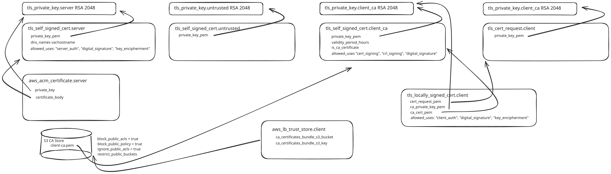
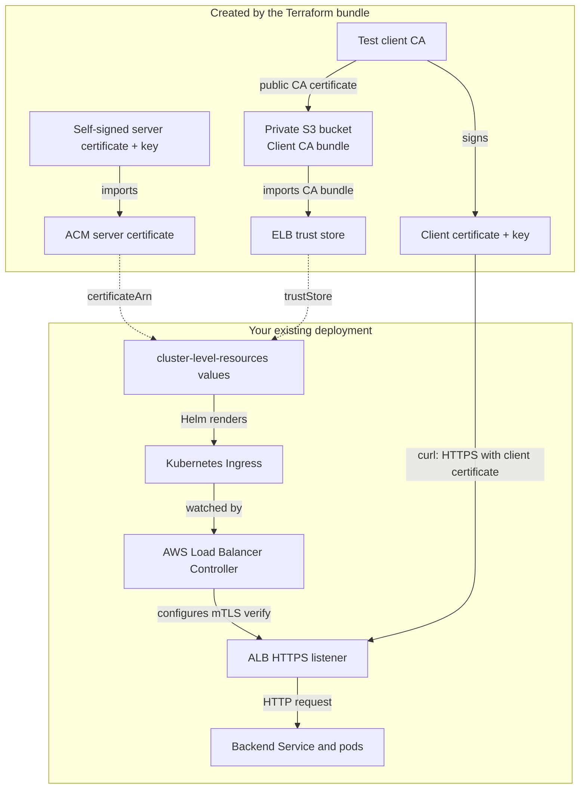

# ALB mTLS prerequisites for an existing Gen3 cluster

This Terraform creates only the AWS prerequisites for these values:

```yaml
alb-controller-mtls:
  ingress:
    certificateArn: arn:aws:acm:REGION:ACCOUNT:certificate/ID
    trustStore: arn:aws:elasticloadbalancing:REGION:ACCOUNT:truststore/NAME/ID
```

AWS resources: one imported ACM server certificate, one ELB trust store, and one
private S3 bucket containing the client CA PEM bundle. A public-access-block
configuration protects the bucket. Local TLS resources generate disposable test
CA/server/client keys and certificates. No EKS, VPC, nodes, IAM roles, controller,
Ingress, Service or ALB is created or modified by this Terraform.

Use your existing cluster-level-resources deployment to configure the listener.
The controller creates/updates the ALB from your Ingress as usual. The ACM server
certificate and the client CA have separate purposes: the former identifies the
server, while the ELB trust store authorizes clients signed by the test client CA.
`trustStore` takes the ELB trust-store ARN, not the S3 URL or the CA PEM.

## Deploy

Requires Terraform >=1.6 and <2, AWS credentials in the same account/region as your
existing ALB, and Python 3 for the optional export. The caller needs ACM import,
S3 read/write and ELB trust-store permissions. Existing controller IRSA must
include `elasticloadbalancing:DescribeTrustStores` and its normal ALB permissions.

```bash
cd alb-mtls-prerequisites
cp terraform.tfvars.example terraform.tfvars
# Edit region and hostname to match your existing test Ingress.
terraform init
terraform validate
terraform plan -out=mtls.tfplan
terraform apply mtls.tfplan
python3 export.py
```

See the exact values at any time:

```bash
terraform output -raw certificateArn
terraform output -raw trustStore
```

Use a separate working directory/state for this smaller bundle. It does not
remove any resources you previously applied from alb-mtls-lab.zip.

## Use with cluster-level-resources

`generated/mtls-values.json` is accepted by Helm as a values file. It contains only
`alb-controller-mtls.ingress.certificateArn`, `trustStore`, and `hostname`.
Merge it after your normal cluster values, for example from this directory:

```bash
helm template cluster-level-resources \
  /absolute/path/to/gen3-helm/helm/cluster-level-resources \
  -f /absolute/path/to/your-cluster-values.yaml \
  -f generated/mtls-values.json \
  --show-only templates/alb-controller-mtls.yaml
```

This only renders. Apply via your existing deployment workflow. Your normal
values must still enable `alb-controller-mtls` and set the backend Service,
namespace, and other settings. The previously inspected branch template had
undefined `$ingress`, `$certificateArn`, and `$trustStore` variables; this smaller
bundle provides infrastructure and does not patch the chart.

## Test your existing endpoint

For the default test hostname, no registered DNS name is required. Substitute
HOST if you changed hostname, and ALB with the real address of your test ALB:

```bash
HOST="mtls.lab.test"
ALB="your-test-alb.REGION.elb.amazonaws.com"
curl --noproxy '*' --http1.1 \
  --cacert generated/server.crt \
  --cert generated/client.crt --key generated/client.key \
  --connect-to "$HOST:443:$ALB:443" \
  "https://$HOST/"
```

`--connect-to` preserves the test hostname for SNI, server certificate validation,
and the Ingress host rule. `--cacert` trusts the self-signed server certificate.
Use the same curl command without `--cert`/`--key` to test missing credentials,
and with `generated/untrusted.crt`/`generated/untrusted.key` to test an untrusted
client. With mTLS verify configured correctly, these requests fail TLS. A valid
client reaches your backend; its HTTP response depends on that application.

The server certificate and CA expire after seven days; client certificates after
six days. Private keys are in Terraform state and exported test client files.
Do not commit state, saved plans, or generated/.

## Cleanup

Remove the test Ingress or otherwise detach these resources from its ALB listener
through your existing workflow before destroying the prerequisites:

```bash
terraform destroy
```

An attached trust store/certificate cannot be deleted. Cleanup here only deletes
the resources managed by this bundle; your existing cluster is outside its state.
S3 and any applicable AWS usage remain billable until deleted.

## Verification

Terraform formatting/HCL parsing and Python syntax were checked locally. Full
provider validation and an AWS plan/apply were not performed: the authoring
runtime blocks Terraform provider Unix sockets. Run the validation and plan
commands above before applying.


## Diagram





